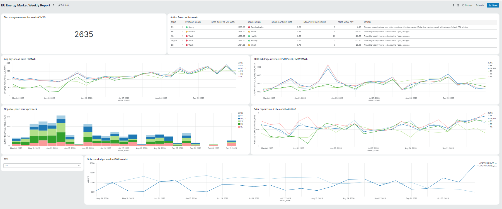
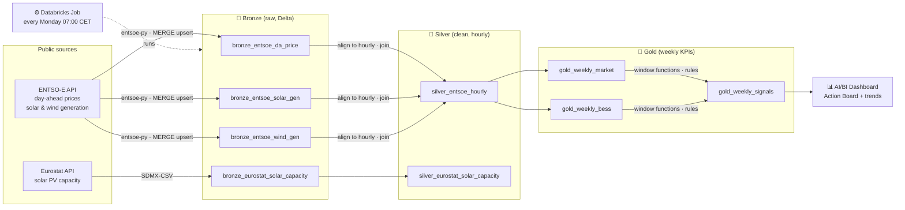

# ☀️🔋 EU Solar & Storage Market Tracker

A weekly, automatically refreshed tracker for European power markets, built on **Databricks (Free Edition)** with **PySpark** and **Delta Lake**, using **only public data** (ENTSO-E Transparency Platform, Eurostat).

It turns raw hourly market data into the signals solar and storage analysts actually look at: **solar capture rate, negative-price hours, daily price spreads and a simple battery (BESS) arbitrage estimate**, plus an **Action Board** that flags what to look at this week.

> Personal learning project. Public data only. Not investment advice.



---

## 🎯 What it answers

| Question | Metric |
|---|---|
| How expensive is power this week, by market? | Avg / min / max day-ahead price |
| Is solar oversupplying the grid? | Negative-price hours per week |
| Is solar cannibalizing its own price? | **Solar capture rate** = solar-weighted price ÷ average price |
| How attractive is battery storage right now? | **BESS arbitrage revenue** (€/MW/week) and avg daily spread |
| Which market is best for storage this week? | Cross-market rank + percentile vs. own history |
| What changed in the generation mix? | Solar vs. wind GWh per week |

**Markets:** NL, DE_LU, BE, FR, ES · **History:** from May 2026, updated every Monday

---

## 🏗️ Architecture



**Design choices**
- **Medallion architecture** (Bronze → Silver → Gold) on Delta Lake
- **Incremental loads**: each run fetches the last 14 days and `MERGE`s on `(zone, ts_utc)`, so re-runs never duplicate and history accumulates
- **Mixed resolutions** (15-min and hourly) are normalized to hourly before joining prices with generation
- **Secrets**: the ENTSO-E token lives in Databricks Secrets, never in code
- **Pipeline vs. scratch**: the scheduled notebook contains only production steps; diagnostics live in a separate notebook

---

## 🔋 BESS arbitrage model

A deliberately simple screening model for a **1 MW / 2 MWh** battery:

- Each day, charge in the **2 cheapest hours** and discharge in the **2 most expensive hours**
- Round-trip efficiency **88%**
- Daily profit = `0.88 × discharge value − charge cost`, floored at 0 (no cycle if the spread is too small)
- Summed per week → **€/MW/week**, plus a ×52 annualized run-rate

**Caveats (read before quoting numbers)**
- Day-ahead arbitrage only: ancillary services, intraday and capacity markets are excluded → understates real revenue stacks
- Perfect foresight and no enforced charge-before-discharge order → overstates achievable DA revenue
- 15-min prices are averaged to hourly → understates intraday spreads
- No degradation, fees or grid charges

Use it as a **relative signal** (market vs. market, week vs. history), not a business case.

---

## 🚦 Action Board logic

| Signal | Rule | Suggested action |
|---|---|---|
| 🔋 Storage | BESS revenue ≥ 75th percentile of the market's own history → 🟢 Strong; ≤ 25th → 🔴 Weak | Deep-dive markets turning 🟢 |
| ☀️ Solar | Capture rate < 0.7 → 🔴 Cannibalization; < 0.9 → 🟡 Watch | Pair solar with storage / revisit PPA pricing |
| ⚡ Grid | ≥ 20 negative-price hours in a week | Flexibility demand rising |
| 📈 Price | Week-over-week avg price change ≥ ±20% | Check drivers: wind, gas, outages |

Thresholds are starting heuristics and easy to tune in the pipeline.

---

## 💡 Findings so far (May–Oct 2026)

- **Coupled markets go negative together**: in the week of 18 May, DE_LU, NL, BE and FR all hit roughly **−€75/MWh**
- **Spain = solar cannibalization + storage opportunity**: in October, ES ranked #1 for storage (~€2,500–2,600/MW/week) while its solar capture rate sat at only 0.39–0.55
- **Peak storage week**: NL, week of 22 June, **~€4,270/MW**, with day-ahead prices up to ~€800/MWh
- **Seasonality**: negative-price hours were frequent from May to August and almost disappeared by October as solar output fell and prices rose

---

## 🧪 Data quality: issues found and handled

| Issue | Diagnosis | Status |
|---|---|---|
| ES wind ≈ 0 MW on average (and DE_LU understated) | Offshore (B18) and onshore (B19) series came back at different resolutions; combining them misaligned timestamps so many rows only carried offshore zeros | ✅ Fixed: each series is resampled to hourly before summing; ES avg now ~4.6 GW, DE_LU ~13.8 GW |
| NL solar only ~10–20 GWh/week | Far below what NL's installed PV implies; the ENTSO-E series for NL appears incomplete | ⚠️ Documented: NL solar volumes and capture rate are indicative only (prices and BESS are unaffected) |
| `ROUND()` shows small negatives as 0 | e.g. −0.04 €/MWh displays as 0 | ℹ️ Known display artifact |
| Partial weeks at the edges | First and current weeks have < 168 hours | ✅ Filtered (`hours_covered ≥ 120`) |

---

## 🧰 Tech stack

Databricks Free Edition (serverless) · PySpark · Delta Lake · Unity Catalog · Databricks Jobs · AI/BI Dashboards · Python (`pandas`, `requests`, `entsoe-py`) · SQL

---

## 📁 Repository structure

```
├── notebooks/
│   ├── 01_eurostat_capacity.py      # Eurostat solar PV capacity → bronze/silver
│   └── pipeline_weekly.py           # Scheduled job: ENTSO-E → bronze → silver → gold → signals
├── dashboard/
│   └── eu_energy_market_weekly.lvdash.json   # Exported AI/BI dashboard
├── docs/
│   └── dashboard.png
└── README.md
```

---

## ▶️ How to run it yourself

1. **Databricks Free Edition**: sign up and create a notebook (Python)
2. **Schema**: `CREATE SCHEMA IF NOT EXISTS workspace.energy_tracker;`
3. **ENTSO-E token**: register on the [Transparency Platform](https://transparency.entsoe.eu/), email `transparency@entsoe.eu` with subject *RESTful API access*, then generate a token under *My Account Settings*
4. **Store the token** in a Databricks secret scope `energy`, key `entsoe_token`
5. **Backfill**: run `pipeline_weekly` with `days_back = 180`
6. **Schedule**: create a Job on `pipeline_weekly` (serverless, `days_back = 14`, Mondays 07:00 Europe/Amsterdam)
7. **Dashboard**: import `dashboard/eu_energy_market_weekly.lvdash.json`

---

## 🗺️ Roadmap

- [ ] Cross-check NL solar against Eurostat installed capacity
- [ ] Add PL, AT and Nordic zones
- [ ] Enforce charge-before-discharge in the BESS model
- [ ] Data quality checks that fail the job on missing zones
- [ ] Policy-update feed (EU and national regulators)

---

## 📜 Data sources & disclaimer

- [ENTSO-E Transparency Platform](https://transparency.entsoe.eu/): day-ahead prices, actual generation per type
- [Eurostat](https://ec.europa.eu/eurostat): `nrg_inf_epcrw` (electricity production capacities for renewables)

Built as a personal project for learning Databricks and PySpark. Uses only publicly available data. Nothing here is investment advice.
